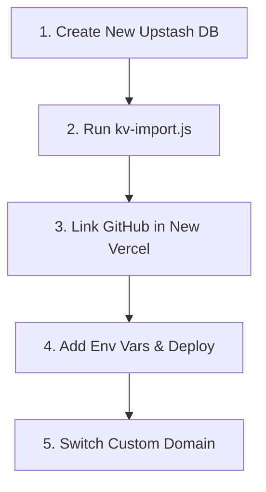
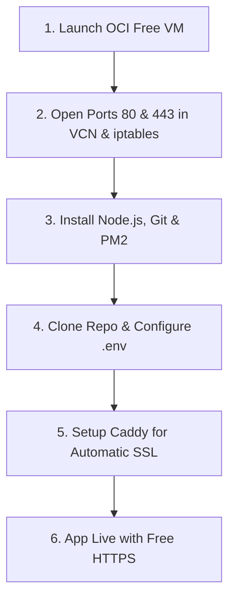

# 🚀 TTS Strategies — Complete Migration Guide
**Target Platforms:** New Vercel Account (Serverless) OR Oracle Cloud Always Free VM (Node.js + PM2 + Reverse Proxy)

---

## 📑 Table of Contents
1. [Architecture Overview](#1-architecture-overview)
2. [Phase 1: Pre-Migration Backup (CRITICAL)](#2-phase-1-pre-migration-backup-critical)
3. [Phase 2 — Path A: Migration to a New Vercel Account](#3-phase-2--path-a-migration-to-a-new-vercel-account)
4. [Phase 3 — Path B: Migration to Oracle Cloud Always Free VM](#4-phase-3--path-b-migration-to-oracle-cloud-always-free-vm)
5. [Phase 4: Post-Migration Verification & Smoke Tests](#5-phase-4-post-migration-verification--smoke-tests)
6. [Troubleshooting & Common Pitfalls](#6-troubleshooting--common-pitfalls)

---

## 1. Architecture Overview

Before migrating, it helps to understand what components make up the application:

```
┌────────────────────────────────────────────────────────────────────────┐
│                        CLIENT / BROWSER                                │
│       (index.html, app.js, style.css, notes.js, capital-planner)       │
└───────────────────────────────────┬────────────────────────────────────┘
                                    │ HTTP / HTTPS
                                    ▼
┌────────────────────────────────────────────────────────────────────────┐
│                        APPLICATION SERVER                              │
│                                                                        │
│   [Vercel Serverless]                        [Oracle VM / Self-Hosted] │
│   • vercel.json rewrites                     • local-server.js         │
│   • api/index.js (single router)             • PM2 Process Manager     │
│   • api/_lib/*.js handlers                   • Caddy / Nginx (SSL)     │
└───────────────────────────────────┬────────────────────────────────────┘
                                    │ HTTPS REST Calls
                                    ▼
┌────────────────────────────────────────────────────────────────────────┐
│                        DATABASE LAYER                                  │
│             Upstash Redis (Serverless KV Store)                        │
│   • Stores: strategies, holidays, notes, whitelist, permissions, logs  │
│   • Queried via HTTP REST: KV_REST_API_URL + KV_REST_API_TOKEN         │
└────────────────────────────────────────────────────────────────────────┘
```

> [!NOTE]
> The app uses **Upstash Redis REST API** for all data storage. This means whether you run on Vercel or an Oracle VM, you can connect to the exact same database without needing to host or maintain a stateful database on the VM itself!

---

## 2. Phase 1: Pre-Migration Backup (CRITICAL)

Before touching any settings or creating new projects, back up all data currently stored in your active database.

### Step 1.1: Record Your Environment Variables
Log into your current Vercel Dashboard, go to **Settings → Environment Variables**, and record the values for:

| Variable | Required? | Purpose |
|:---|:---:|:---|
| `JWT_SECRET` | **YES** | Encrypts user login session tokens (min 32 chars) |
| `ADMIN_JWT_SECRET` | **YES** | Encrypts admin console session tokens (min 32 chars) |
| `ADMIN_PASSWORD` | **YES** | Password used to log into `/admin.html` |
| `KV_REST_API_URL` | **YES** | Upstash Redis REST endpoint (`https://...upstash.io`) |
| `KV_REST_API_TOKEN` | **YES** | Upstash Redis REST bearer token |
| `GEMINI_API_KEY` | Optional | Powers AI Co-Pilot & Daily Strategy Briefing |
| `TELEGRAM_BOT_TOKEN` | Optional | Telegram authentication / dispatch bot |
| `TELEGRAM_BOT_USERNAME` | Optional | Telegram username for login widget |
| `TELEGRAM_WEBHOOK_SECRET`| Optional | Secret token for Telegram webhooks |
| `CRON_SECRET` | Optional | Secures automated daily briefing triggers |

### Step 1.2: Export Database to `kv-backup.json`
The repository includes an automated export utility in `scripts/kv-export.js`.

1. Open PowerShell or Terminal in your project root:
   ```bash
   cd c:\02-PKM\Projects\TTS-Strategies
   ```
2. Run the export script using your current KV credentials:
   ```powershell
   # Windows PowerShell
   $env:OLD_KV_URL="https://YOUR-CURRENT-DB.upstash.io"
   $env:OLD_KV_TOKEN="YOUR_CURRENT_TOKEN"
   node scripts/kv-export.js
   ```
   *(Or on Linux/macOS: `OLD_KV_URL="..." OLD_KV_TOKEN="..." node scripts/kv-export.js`)*

3. Verify the output:
   The script will generate `kv-backup.json` in your project folder, containing:
   - ✅ `strategies` (all custom strategy entries)
   - ✅ `holidays` (trading holidays)
   - ✅ `notes` (knowledge base notes & blueprints)
   - ✅ `whitelist` (user phone numbers and encrypted PINs)
   - ✅ `user_permissions` (catalog / journal feature flags)
   - ✅ `user_capital` (saved trading capital numbers)
   - ✅ `user_terms_consent` (disclaimer consent timestamps)
   - ✅ `auth_audit_logs` & `user_activity_logs`

> [!CAUTION]
> Keep `kv-backup.json` secure! It contains your user whitelist and custom strategies. Do not commit it to a public GitHub repository.

---

## 3. Phase 2 — Path A: Migration to a New Vercel Account

Follow these steps if you want to deploy to a brand-new Vercel account.



### Step 2.1: Grant the New Vercel Account Access to GitHub
1. Log into your new Vercel account at [vercel.com](https://vercel.com).
2. Connect your GitHub account (`srkdroid` or your new account).
3. If using an organization or different GitHub user, ensure the repository `tts-strategies` is accessible.

### Step 2.2: Create a Fresh Upstash Redis Database
You have two choices:
- **Option A (Via Vercel Storage):** In your new Vercel project, go to **Storage → Create Database → KV / Upstash**.
- **Option B (Direct via Upstash.com - Recommended):**
  1. Sign up at [upstash.com](https://upstash.com) (free forever tier, 10,000 commands/day).
  2. Click **Create Database**.
  3. Name: `tts-strategies-db`, Region: `ap-south-1 (Mumbai)` or closest to your users.
  4. Once created, scroll down to **REST API** section and copy:
     - `UPSTASH_REDIS_REST_URL` ➔ `KV_REST_API_URL`
     - `UPSTASH_REDIS_REST_TOKEN` ➔ `KV_REST_API_TOKEN`

### Step 2.3: Import Your Data into the New Database
From your local terminal, run the import script to restore all your backed-up data:
```powershell
# Windows PowerShell
$env:NEW_KV_URL="https://YOUR-NEW-DB.upstash.io"
$env:NEW_KV_TOKEN="YOUR_NEW_TOKEN"
node scripts/kv-import.js
```
The script will write all your strategies, notes, whitelist, and settings into the new database.

### Step 2.4: Deploy Project on New Vercel
1. In the new Vercel dashboard, click **Add New... → Project**.
2. Select your `tts-strategies` repository and click **Import**.
3. Configure settings:
   - **Framework Preset**: `Other`
   - **Root Directory**: `./` (leave default)
   - **Build Command**: Leave empty (static site + serverless functions)
   - **Output Directory**: Leave empty
4. Expand **Environment Variables** and paste all variables recorded in Step 1.1:
   - `JWT_SECRET`
   - `ADMIN_JWT_SECRET`
   - `ADMIN_PASSWORD`
   - `KV_REST_API_URL` (new database URL)
   - `KV_REST_API_TOKEN` (new database token)
   - `GEMINI_API_KEY` (if using AI features)
5. Click **Deploy**.

### Step 2.5: Transfer Custom Domain (Optional)
If you are using a custom domain (e.g. `ttsmaster.vercel.app` or a custom `.com`/`.in` domain):
1. In the **old** Vercel account: Go to Project **Settings → Domains** and click **Remove**.
2. In the **new** Vercel account: Go to Project **Settings → Domains** and click **Add**.
3. Follow the DNS verification instructions if using a custom registrar.

---

## 4. Phase 3 — Path B: Migration to Oracle Cloud Always Free VM

Oracle Cloud Infrastructure (OCI) offers an **Always Free tier** that includes:
- Up to **4 OCPU cores** and **24 GB RAM** (Ampere A1 ARM compute) or **1 OCPU / 1 GB RAM** (AMD Micro).
- 200 GB of free block storage.
- Free static public IPv4 address.
- **Never expires, no monthly bill.**



---

### Step 3.1: Create Your OCI Free Compute Instance
1. Log into your Oracle Cloud Console at [cloud.oracle.com](https://cloud.oracle.com).
2. Go to **Compute → Instances → Create Instance**.
3. Settings:
   - **Name**: `tts-server`
   - **Image**: `Canonical Ubuntu 24.04` or `Ubuntu 22.04 Minimal`
   - **Shape**:
     - *Preferred*: **Ampere (ARM)** `VM.Standard.A1.Flex` with 2 OCPU and 12 GB RAM (Always Free Eligible).
     - *Alternative*: **AMD (x86)** `VM.Standard.E2.1.Micro` with 1 OCPU and 1 GB RAM (Always Free Eligible).
   - **Networking**: Create new VCN (default settings). Ensure **Assign a public IPv4 address** is checked.
   - **SSH Keys**: Download both the Private Key and Public Key (save `ssh-key.key` to your PC).
4. Click **Create** and wait 60 seconds for status to turn **Running**. Note your **Public IP Address** (e.g., `129.154.xx.xx`).

---

### Step 3.2: Open Ports in OCI Security List
By default, Oracle blocks all incoming traffic except SSH (port 22). You must allow HTTP and HTTPS:
1. In the instance details page, click on your **Subnet** link under Primary VNIC.
2. Click on the **Default Security List for your VCN**.
3. Under **Ingress Rules**, click **Add Ingress Rules**:
   - **Rule 1 (HTTP)**:
     - Source CIDR: `0.0.0.0/0`
     - IP Protocol: `TCP`
     - Destination Port Range: `80`
     - Description: `Allow HTTP`
   - **Rule 2 (HTTPS)**:
     - Source CIDR: `0.0.0.0/0`
     - IP Protocol: `TCP`
     - Destination Port Range: `443`
     - Description: `Allow HTTPS`
4. Click **Add Ingress Rules**.

---

### Step 3.3: Connect via SSH & Configure the VM OS Firewall
Oracle Ubuntu images have built-in `iptables` rules that block incoming ports even if OCI Security Lists are open.

1. Connect to the VM from your local terminal:
   ```bash
   ssh -i /path/to/ssh-key.key ubuntu@YOUR_VM_PUBLIC_IP
   ```

2. Update system packages and configure `iptables` to allow ports 80 and 443:
   ```bash
   sudo apt update && sudo apt upgrade -y
   
   # Open ports 80 and 443 in host firewall
   sudo iptables -I INPUT 6 -m state --state NEW -p tcp --dport 80 -j ACCEPT
   sudo iptables -I INPUT 6 -m state --state NEW -p tcp --dport 443 -j ACCEPT
   
   # Make iptables rules persistent across reboots
   sudo apt install -y iptables-persistent
   sudo netfilter-persistent save
   ```

---

### Step 3.4: Install Node.js LTS, Git & PM2
Run the following on your VM:
```bash
# Install Node.js 22 LTS
curl -fsSL https://deb.nodesource.com/setup_22.x | sudo -E bash -
sudo apt install -y nodejs git

# Verify installation (should be v22.x and v10.x)
node -v
npm -v

# Install PM2 process manager globally
sudo npm install -g pm2
```

---

### Step 3.5: Deploy Application Code & Configure Environment
1. Clone your repository:
   ```bash
   sudo git clone https://github.com/srkdroid/tts-strategies.git /var/www/tts-strategies
   sudo chown -R ubuntu:ubuntu /var/www/tts-strategies
   cd /var/www/tts-strategies
   ```

2. Install dependencies:
   ```bash
   npm install --production
   ```

3. Create the production `.env` file:
   ```bash
   nano .env
   ```
   Paste your configuration:
   ```env
   PORT=3000
   NODE_ENV=production
   
   JWT_SECRET=your_jwt_secret_min_32_chars
   ADMIN_JWT_SECRET=your_admin_jwt_secret_min_32_chars
   ADMIN_PASSWORD=your_secure_admin_password
   
   KV_REST_API_URL=https://your-upstash-db.upstash.io
   KV_REST_API_TOKEN=your_upstash_token
   
   GEMINI_API_KEY=your_gemini_api_key
   ```
   Save and exit (`Ctrl + O`, `Enter`, `Ctrl + X`).

4. If you have a `kv-backup.json` from Phase 1, import your data:
   ```bash
   # In /var/www/tts-strategies
   export NEW_KV_URL="https://your-upstash-db.upstash.io"
   export NEW_KV_TOKEN="your_upstash_token"
   node scripts/kv-import.js
   ```

---

### Step 3.6: Run the App with PM2 (Auto-Restart on Boot)
PM2 ensures the server runs 24/7 in the background and restarts automatically if it crashes or the VM reboots.

1. Start the server using `local-server.js`:
   ```bash
   cd /var/www/tts-strategies
   pm2 start local-server.js --name "tts-strategies" --env .env
   ```

2. Configure PM2 to start on system boot:
   ```bash
   pm2 startup
   ```
   *(Copy and paste the `sudo env PATH=...` command printed on the screen)*

3. Save the PM2 process list:
   ```bash
   pm2 save
   ```

4. Check that the server is responding locally:
   ```bash
   curl -I http://localhost:3000
   ```
   You should see `HTTP/1.1 200 OK`.

---

### Step 3.7: Setup Caddy Reverse Proxy (Free Automated HTTPS)
**Caddy** is the simplest and most reliable modern reverse proxy. It automatically obtains, installs, and renews free SSL certificates from Let's Encrypt with zero configuration.

1. Install Caddy on Ubuntu:
   ```bash
   sudo apt install -y debian-keyring debian-archive-keyring apt-transport-https curl
   curl -1sLF 'https://dl.cloudsmith.io/public/caddy/stable/gpg.key' | sudo gpg --dearmor -o /usr/share/keyrings/caddy-stable-archive-keyring.gpg
   curl -1sLF 'https://dl.cloudsmith.io/public/caddy/stable/debian.deb.txt' | sudo tee /etc/apt/sources.list.d/caddy-stable.list
   sudo apt update
   sudo apt install -y caddy
   ```

2. Configure Caddy:
   ```bash
   sudo nano /etc/caddy/Caddyfile
   ```

   - **If you have a domain name** (e.g., `tts.yourdomain.com` pointing to your VM Public IP):
     ```caddy
     tts.yourdomain.com {
         reverse_proxy localhost:3000
     }
     ```
     *(Caddy will automatically issue a valid SSL certificate for your domain!)*

   - **If using Public IP only** (without custom domain):
     ```caddy
     :80 {
         reverse_proxy localhost:3000
     }
     ```

3. Restart Caddy:
   ```bash
   sudo systemctl restart caddy
   sudo systemctl status caddy
   ```

4. **Done!** Open `https://tts.yourdomain.com` (or `http://YOUR_VM_PUBLIC_IP`) in your browser. The app is live!

---

## 5. Phase 4: Post-Migration Verification & Smoke Tests

Verify all critical features to ensure complete operational parity:

| Test Case | How to Test | Expected Result |
|---|---|---|
| **Home Page** | Open `https://your-app/index.html` | Dashboard renders with theme and navigation |
| **Strategy Master Catalog** | Open **Strategy Catalog** tab | All 18 strategies appear with 15:30 times |
| **Capital Flow Gantt** | Switch to **Capital Flow** view | Bars render; same-day rolls show clean gap |
| **Admin Login** | Open `/admin.html` and enter admin password | Admin bar activates; settings modal opens |
| **Knowledge Base** | Open **Notes** section | All seed notes and restored blueprints appear |
| **Strategy Persistence** | Edit a strategy in Admin Console and refresh | Changes persist without reverting |
| **AI Co-Pilot** | Click AI Assistant and ask a query | Responds with live strategy context |

---

## 6. Troubleshooting & Common Pitfalls

### Issue 1: Vercel Hobby Plan "Commit Author" Block
- **Cause**: Vercel Hobby tier blocks git pushes if the git commit author email doesn't match the Vercel project owner.
- **Fix**: In your local repository, configure git author to your verified GitHub email:
  ```bash
  git config user.name "srkdroid"
  git config user.email "94727335+srkdroid@users.noreply.github.com"
  ```

### Issue 2: Oracle Cloud VM Port 80/443 Not Reachable
- **Cause**: Oracle has two firewalls: the Cloud VCN Security List AND the VM's internal `iptables`. Both must allow traffic.
- **Fix**:
  1. Ensure Ingress Rules for ports 80 and 443 are in your OCI VCN Security List.
  2. Run the `iptables` commands from Step 3.3 and verify with:
     ```bash
     sudo iptables -L -n -v | grep -E "80|443"
     ```

### Issue 3: Strategies Reverting on Restart
- **Cause**: The auto-merge logic in `api/_lib/data.js` checks disk strategies.
- **Fix**: Always make permanent strategy deletions from `strategies.js` so disk and database stay in sync.

### Issue 4: Keeping PM2 Running After Terminal Disconnects
- **Check PM2 logs**: `pm2 logs tts-strategies`
- **Restart PM2 service**: `pm2 restart tts-strategies`
- **Check memory/CPU**: `pm2 status`
